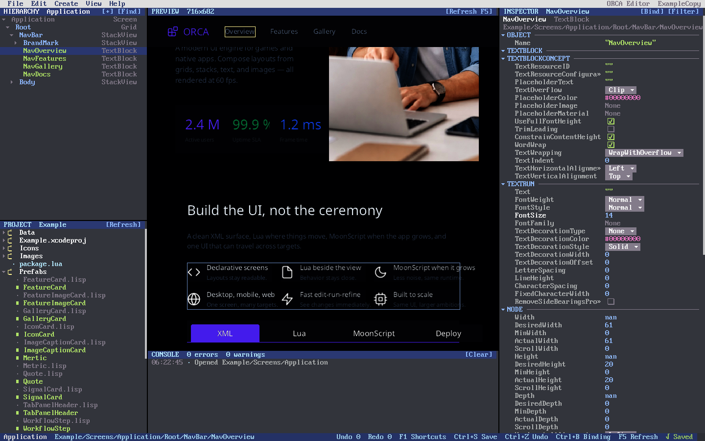
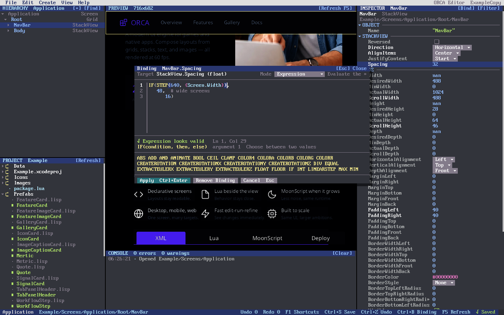

# ORCA Editor

A live editor for ORCA projects, laid out like Kanzi Studio and Unity:
Hierarchy and Project on the left, a rendered Preview with a Console below
it, and the Inspector on the right. The edited project runs in a separate
`orca -server=true` process; every change is applied to that running scene
and the preview is re-rendered from it.



## Running

```bash
make editor                       # edits apps/Example
make editor PROJECT=apps/Weather  # any XML project
cd apps/Editor && make run PROJECT=../Example
```

`ORCA_EDITOR_PROJECT` selects the project when launching `orca apps/Editor`
directly. `ORCA_EDITOR_DEBUG=1` traces pointer and key routing to stderr.

## Common tasks

| Task | How |
|---|---|
| Open a screen or prefab | Double-click it in Project, or File > Open Document |
| Select a node | Click it in Hierarchy or in the Preview (hover shows the node under the pointer) |
| Find a node | Ctrl+F, or start typing in Hierarchy; Esc clears |
| Create a child | Create menu, Hierarchy `[+]`, or right-click > Create Child (common classes first, the rest under More) |
| Rename, duplicate, delete | F2 / Ctrl+D / Delete, or the Hierarchy context menu |
| Edit a value | Click it in the Inspector: checkboxes toggle, enums open a dropdown, other values edit inline |
| Bind a property | Click the gutter left of a property, press Ctrl+B, or right-click > Add Binding |
| Undo / redo | Ctrl+Z / Ctrl+Shift+Z (also Ctrl+Y) |
| Save | Ctrl+S writes the open document back to its XML file |

Help > Keyboard Shortcuts (F1) lists every shortcut. Menus open from the menu
bar, with Alt+letter, or by right-clicking; they support submenus, check marks,
disabled items, shortcuts, arrow-key navigation and first-letter jumps.

## Binding editor



The binding editor is a modal code editor for ORCA binding expressions:

- syntax highlighting for functions, `{property}` paths, numbers, strings and
  `#` comments; unknown functions are shown in red;
- bracket matching around the caret and unbalanced brackets marked as errors;
- signature help for the call around the caret (`STEP(edge, x)`, argument 2);
- completion of functions and of `{` property paths (Ctrl+Space, Tab or Enter
  to accept), plus a clickable function palette;
- auto-closed brackets and quotes, multi-line editing with indentation;
- a binding mode selector (Expression, OneWay, TwoWay, OneWayToSource,
  OneTime) with mode-specific checks;
- diagnostics before Apply, and the server's error if it rejects the binding.

The binding VM reads a newline as a statement separator, so the editor joins
the lines (dropping `#` comments) into one expression when it applies it.

## Architecture

| File | Role |
|---|---|
| `App.lua` | Application shell: layout, menus, global shortcuts |
| `Scripts/Workspace.lua` | Server process, requests, selection, undo/redo, events |
| `Scripts/Terminal.lua` | Character-grid panel on `ConsoleView`: items, hit testing, keys |
| `Scripts/Menu.lua`, `MenuBar.lua`, `Popups.lua` | Dropdown/context menus and the popup layer |
| `Scripts/Hierarchy.lua`, `ProjectView.lua`, `Inspector.lua` | Panels |
| `Scripts/Preview.lua` | Snapshot image, selection and hover outlines, click-to-select |
| `Scripts/BindingEditor.lua`, `Syntax.lua` | Binding editor and its pure-Lua tokenizer |
| `Scripts/Xml.lua` | Reader for server replies (plain Lua tables) |

The server side is `plugins/EditorKit/server.c`. Requests are single lines,
`<method>/<route><path>?<args>`, with percent-encoded paths and values; each
reply is an XML `<response status="success|error">` document.

| Route | Purpose |
|---|---|
| `get/project-overview` | Project files on disk; scenes are openable documents |
| `get/startup-screen`, `get/scene-hierarchy/<doc>` | Node tree |
| `get/node/<path>` | Properties grouped by class, with `data-id`, `data-set` and `data-program` (binding) |
| `put/node/<path>?Prop=value` | Set values; the reply carries the previous values for undo |
| `put/binding/<path>?property=&expression=&mode=` | Set or (empty expression) remove a binding |
| `post/node/<parent>?class=&name=`, `post/duplicate/<path>`, `delete/node/<path>` | Structure |
| `get/snapshot/<doc>?width=&height=&file=` | Render offscreen to PNG, plus each node's rectangle |
| `get/binding-functions`, `get/class/<base>` | Completion data |
| `post/save/<doc>` | Replay this session's edits onto the source XML |

## Saving

Saving does not serialize the runtime tree, which would inline resolved
styles and theme values. The server records each successful edit and replays
it onto the document's source file with libxml2: attributes are set,
`<BindingExpression>` children replaced, nodes created, renamed, duplicated or
removed, and everything else (comments, style references, `$theme` values,
the DOCTYPE) is kept. Edits under elements without a `Name` in the source
cannot be located; Save reports them in the Console and keeps them pending.

Known limitation: libxml2 writes each element's attributes on one line, so
attribute lists that were wrapped across lines in the source are re-flowed on
the first save.
