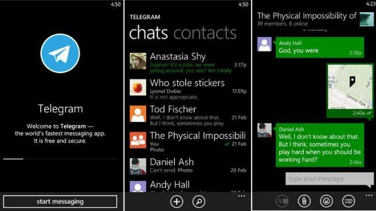
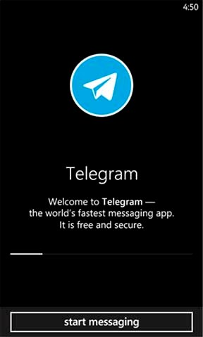

# Chat visual direction: Windows Phone

Decision recorded 2026-10-28. Windows Phone / Metro is the current visual
direction for Chat. Use its typography, Pivot navigation, square geometry,
accent colour, and compact command bars when reviewing or extending the app.
This is a Chat product choice; other ORCA apps may follow different styles.

For authoring and message-list behavior, start with the
[Windows Phone chat source research](docs/windows-phone-chat-architecture.md).
It records Telegram's XAML collection bindings, MVVM references, etlua's role,
and proposed improvements and fixture scenes; these are not an implemented
Chat architecture migration.

## References and their limits

- **Platform guidance:** Microsoft's [WinJS on Windows Phone 8.1](https://blogs.windows.com/windowsdeveloper/2014/04/18/winjs-on-windows-phone-8-1/)
  (Josh Rennert, 18 April 2014) describes Pivot navigation and two closed
  app-bar states: minimal shows the ellipsis; compact shows up to four buttons.
  Expanding the bar reveals labels and additional commands. It also describes
  text inputs filling their parent and adapting to rotation. This supports a
  compact command area, but does not prescribe Chat's sync-status policy or
  message-photo layout.
- **Historical Telegram image:** [Telegram for Windows Phone on Wikimedia Commons](https://commons.wikimedia.org/wiki/File:Telegram_Windows_Phone.jpg)
  provides a dated visual comparison. The downloaded image is a **welcome
  screen**, not an inbox or conversation: use it for typography, contrast and
  period context, not as evidence of composer, timestamp or bubble behaviour.
- **Telegram chat-list/conversation composite:** the [user-supplied screenshot](docs/references/telegram-windows-phone-composite.jpeg)
  below shows actual messaging screens and is the more useful reference for
  chat layout. Its original publication, app version and licence are unknown;
  observations apply only to the screens visible in this image.
- **Existing ORCA research:** [Windows Phone page transitions](../../docs/windows-phone-transitions.md)
  records sources and distinguishes verified behaviour from design decisions
  and inference. [UI system documentation](../../docs/UI_SYSTEM.md) describes
  the engine controls used by Chat.

Platform guidance and historical app screenshots are references, not proof
that every current Chat detail reproduces a particular Messenger or Telegram
release. Record a source and the screen/version it actually shows before
claiming historical fidelity.

## Current product decisions

- App branding uses the existing orca-in-a-chat-bubble artwork on its purple
  gradient tile in authentication. Launch and session loading use the artwork
  with its square background removed over the same full-screen diagonal purple
  gradient in both themes. The fallback canvas is the gradient midpoint (`#7930ff`).
  Messenger blue remains the accent for controls and conversations.
- Keep the footer focused on commands or composing a message. Do not show
  permanent captions such as “Conversations update automatically” or
  “Synced · updates automatically”, and do not reserve an empty status row.
  Show loading, failures and retry actions only when relevant.
- The inbox uses a compact `ApplicationBar` with round commands and an
  ellipsis for secondary actions. A conversation uses attach, message input
  and send in its composer, without another command row below it.
- Use prominent Pivot titles, square avatars, pale text inputs, and the
  black/white palettes with Messenger blue. Keep controls legible and usable
  on the current host platform, including its safe areas and back navigation.
- Button rings use `:focus-visible`: keyboard use reveals them, while touch
  and mouse clicks clear them. Text fields retain `:focus` editing feedback.
  WPF separates focus from its keyboard-only
  [FocusVisualStyle](https://learn.microsoft.com/en-us/dotnet/desktop/wpf/advanced/styling-for-focus-in-controls-and-focusvisualstyle).
  Our programmatic focus follows the current input mode rather than exactly
  reproducing WPF's programmatic-focus suppression. Windows Phone's shared
  Silverlight API retains focused/unfocused states, but Microsoft Press's
  [Programming Windows Phone 7, p. 601](https://fizyka.umk.pl/~jacek/docs/net/Microsoft_Press_ebook_Programming_Windows_Phone_7_PDF.pdf)
  identifies pressed and disabled feedback as relevant for phone buttons.
  This supports the touch interaction choice; an exact WP8 default-template
  comparison has not been verified, and this is not a claim that Phone had
  no focus system.
- Group consecutive messages from the same sender, with one tail per run
  where applicable. Show sender names in group conversations. Text and
  captioned-photo bubbles keep a separate trailing timestamp row.
- A photo without text is an edge-to-edge rectangle with **no coloured
  footer and no tail**. Place its timestamp over the bottom-right of the image
  on a dark translucent backing so it remains readable. Captioned photos
  retain their caption and timestamp below the image.
- Tapping a message photo opens the full stored JPEG on black, fitted without
  cropping and letterboxed as needed. Keep a clear back action, preserve the
  conversation on close, and leave edit/delete commands in a compact photo menu.
  Conversation photos use the full JPEG rather than enlarging a thumbnail.

These are Chat decisions agreed during the 2026-10-28 review, rather than
requirements established by the linked Microsoft article. Clipping an image
to a bubble shape with a real mask is a legitimate rendering technique if
needed later; the current photo-only design deliberately uses a rectangle.

Earlier modern chat references remain linked in the [README](README.md) as
background research. Windows Phone is the primary reference for current
visual changes.

## Archived screenshots

### Telegram chat list and conversation (user supplied)

Unmodified copy of `images 2.jpeg`, supplied by the user on 2026-10-28;
620 × 348 pixels. Original source, date/version and licence have not been
established. Kept as documentation reference material; not an application asset.

Visible observations:

- Black canvas, prominent “chats / contacts” navigation, square avatars,
  compact preview rows, right-aligned dates/times, and a bottom app bar.
- Angular message bubbles, sender names in the group conversation, and
  timestamps near the bottom-right of messages. The map/image message has
  its timestamp over the image without a separate coloured footer.
- A pale message input and no routine sync caption in the pictured footer.
- This Telegram conversation also has a command bar below the input. Our
  chosen Messenger-style composer omits that additional row. The green
  bubbles and smaller conversation title are also historical app details,
  rather than a requirement to replace Chat's blue accent or title treatment.

The resolution is too low to establish exact spacing, font metrics, grouping
rules, or image-tail clipping. Use it for visual comparison, not pixel-exact
measurements or claims about unseen states.

### Telegram welcome screen (Commons)

- Local file: [telegram-windows-phone-2014.jpg](docs/references/telegram-windows-phone-2014.jpg),
  unmodified JPEG, 288 × 479 pixels, 23,599 bytes; downloaded 2026-10-28.
- Author credited by Commons: Telegram Messenger LLP. Date listed:
  25 November 2014.
- [File description and licence notices](https://commons.wikimedia.org/wiki/File:Telegram_Windows_Phone.jpg);
  Commons identifies GPL version 2 or later and includes a separate simple-logo
  public-domain notice. Preserve these source notices when reusing the image.
- [Original JPEG](https://upload.wikimedia.org/wikipedia/commons/e/ef/Telegram_Windows_Phone.jpg)
  and [original article credited by Commons](http://www.tuexpertoapps.com/2014/11/25/telegram-nueva-version-para-windows-phone-con-mas-privacidad/).

This asset is documentation reference material, not a bundled application asset.
