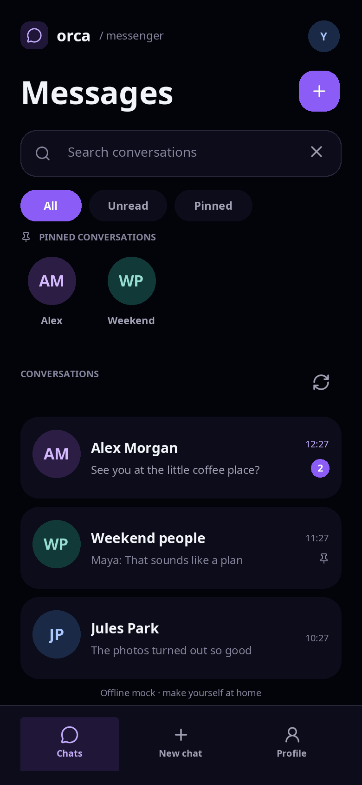

# ORCA Messenger

A simple person-to-person chat app in Lua, using the `Application` entry point
with separate service modules and a shared Windows Phone application shell.
Runs on macOS with a **390 × 844** portrait viewport and on iPhone/iPad with
an adaptive viewport, touch scrolling and the native keyboard. iOS builds use
Make and the Xcode command-line tools without an Xcode project.



[Light mode](preview-light.png) · [Message thread preview](thread-preview.png)

[New conversation](new-preview.png) · [Profile](profile-preview.png) · [Sign in](auth-preview.png)

## Design

Windows Phone / Metro is the current visual direction, with Facebook Messenger
on Windows Phone as the app's established inspiration. See the
[design decisions and historical references](DESIGN.md), including Microsoft's
app-bar guidance and an archived Telegram screenshot. The app uses the
engine's Windows Phone controls (see `docs/UI_SYSTEM.md`):

- The inbox is a `Pivot` titled MESSENGER whose items are the all, unread
  and pinned lists. Swipe the list or tap a header to switch.
- Every other page is a locked one-item `Pivot`, so its title and page name
  share the inbox metrics.
- Commands live in an `ApplicationBar`. On the root pages its round buttons
  switch between chats, new chat and profile, and its menu holds refresh and
  sign out. A conversation has no command row, after Windows Phone
  Messenger: its title line, a round back button before MESSENGER, goes back,
  as does a swipe in from the left edge, and tapping its name opens the
  conversation info, which goes back the same way and whose bar holds pin.
  Attach and send sit in the composer.
- Opening a conversation or its info plays the Windows Phone turnstile: the
  page in view turns away on a hinge at the left edge of the screen, then
  the next page turns in. Going back reverses the rotation. Desktop feathers
  the elements from top to bottom; iOS uses Core Animation to turn each page
  snapshot as one plane. Incoming snapshots refresh when messages load during
  the turn, without restarting it. See [native motion](../../docs/IOS.md#native-motion).
- Text boxes are pale with dark text in both themes and turn white with an
  accent border when focused. Secondary buttons are 2-pixel outlines,
  primary commands are filled with the accent, and links are plain accent
  text.
- Avatars are square solid-colour tiles with initials, replaced by the
  person's Octopus profile photo in direct chats, member and contact lists and
  your profile. Message bubbles are square, with
  Windows Phone tails, and sized to their text. Consecutive messages from one
  sender stack tightly and share one tail, sender names appear only in group
  chats, and text or captioned-photo bubbles have a trailing timestamp row.
  Photos fill their bubble edge to edge. A photo without text has no footer or
  tail; its timestamp overlays the bottom-right of the image on a dark backing.
  Visible photos show the stored thumbnail while the full JPEG loads, then
  replace it automatically. Tapping opens a black, letterboxed viewer with a
  close action and the same preview-to-full behavior. New uploads preserve aspect
  ratio within 1.5 megapixels and a 1600-pixel longest edge, never enlarge, and fit
  250,000 bytes
  per JPEG. Compression adjusts quality before reducing dimensions. The separate
  256-pixel thumbnail is temporary and never enters the full-photo cache. Both
  stages use the authenticated photo API; no public preview of encrypted Chat
  files is requested. If the full download fails, the thumbnail remains with a
  retry action. Older uploads remain readable at their stored size.
- Keep the footer free of routine sync captions and empty status rows. Show
  loading, errors and retry actions only when relevant.

`theme.lua` holds a black and a white palette with Messenger blue. The OS
appearance chooses between them; set `CHAT_APPEARANCE=light` or `dark` to
override it. On Linux, ORCA reports dark mode when `GTK_THEME` contains
`dark`. `Styles/app.css` adds hover and focus states with `:dark` variants.
Icons are stroke-based Lucide SVGs with inherited tint.

`views/shell.lua` owns one persistent `ApplicationBar` for Chats, New chat, and
Profile. It sets `PageHost.ActivePage` and disables the button for the page in
view. Root pages keep their instances and form drafts when you switch pages.
Conversation and sign-in screens are separate flows, and returning to the root
reuses the same shell.

Message and photo rows live in `Templates/Message.xml` and `Templates/Photo.xml`.
The timeline computes presentation fields and maps message IDs to stable typed
DataObjects through `orca.UIKit.ItemsView`; native ItemsControl observes source
changes and owns the rows. Polls update existing fields and neighboring grouping
without replacing unaffected messages or loaded photo content. Text, captioned
photos and photo-only messages use bound section visibility in the same template.

The inbox prepares all three filtered lists when data or search changes. Swiping
only updates selection, keeping row instances and scroll positions intact instead
of allocating rows during the transition. Pivot also retains spare repeating
headers while dragging and keeps the page opaque when a short swipe settles back.
This trades a few retained lists for less work during touch interaction.

The performance approach follows Windows Phone 7's use of GPU/composition-thread
animations to reduce work on the UI thread ([Microsoft's WP7 performance article](https://download.microsoft.com/download/3/1/b/31b6c512-d66f-4138-b639-94711e95faca/msdn_0411dg.pdf)).
Off-thread input for Panorama and Pivot was a later [Windows Phone 8 improvement](https://blogs.windows.com/windowsdeveloper/2012/11/05/windows-phone-8-developer-platform-highlights/).
These changes remove allocation and a visible fade from ORCA's swipe path; ORCA
still performs layout during animation, so device frame-time profiling remains
necessary before claiming WP7-like smoothness.

Search matches conversation names and message previews. The all, unread and
pinned pivots filter locally; opening a conversation clears its local unread
badge. Use pin in a conversation's info (tap its name) to add or remove it
from the pinned pivot. Drafts survive navigation
and pinning. Pins and unread state last for this app session.

Open conversations update automatically every 3 seconds; the visible inbox
updates every 15 seconds. Polling pauses with the iOS scene and refreshes on
return, backs off on service errors, and preserves scroll position and drafts.
The manual refresh commands remain available.

Opening a conversation and each poll request the latest **30 messages**. Scrolling
within 160 pixels of the top requests the next 30 older messages through an
opaque cursor; the first visible message stays at the same screen position when
the page is prepended. The history row shows loading or an explicit retry action,
and a deleted cursor offers **reload latest**. Requests are serialized, duplicate
IDs are removed, and composer/photo drafts survive these updates. The loaded
window is scoped to one thread and grows as you request earlier pages; opening
a thread replaces that window with the newest page. A burst exceeding the latest
page while reading history offers **show latest**, avoiding a hidden gap between
pages. This follows the on-demand, scroll-up history pattern in
[Microsoft’s chat SDK](https://github.com/microsoft/omnichannel-chat-sdk/blob/main/README.md#get-persistent-chat-history)
and the visible-item preservation behavior documented for
[UWP item updates](https://learn.microsoft.com/en-us/uwp/api/windows.ui.xaml.controls.itemsupdatingscrollmode).
These are interaction references; the visual direction remains Windows Phone.

New Message follows Telegram's task flow within the existing Metro style:
search, New Group, New Channel, and contacts. Tap a person to open a direct chat.
Groups select members before the name step; Back preserves that selection and
name draft. Channels start with a name and private/public visibility, and people
join separately. Channel browsing and invitation entry have separate views.
No contact is required for discovery: exact public usernames are searchable;
email and phone require a verified identifier and that person's discovery opt-in
in Profile. Display names are separate from public usernames.

Route constructors attach the shell, navigation and composer before scheduling
Appwrite work with `orca.async`. Session restoration, inboxes, profiles, contacts,
members and initial messages show UIKit's centered `ActivityIndicator` while their
requests yield. Search and navigation remain usable; message loads preserve edits
to the composer. Retained tabs may finish loading in the background without being
selected, while session changes and discarded detail screens reject late results.
Failed first loads offer retry and are distinct from empty conversations.

Earlier visual research included [Orbit Messenger on Dribbble](https://dribbble.com/shots/27279050-Orbit-Messenger-Dark-Mode-UI-Concept),
[Chat App Design on Behance](https://www.behance.net/gallery/186704313/Chat-App-Design-Dark-UI),
and [Appetite UI's chat patterns](https://www.appetiteui.com/screens/patterns/chat).
These informed the avatar shortcuts, inbox hierarchy, quiet metadata, and fixed composer.
Use [Windows Phone references](DESIGN.md) as the primary direction for current changes.

## Run

From the repository root, build ORCA as described in `docs/BUILD.md`, then run:

```sh
build/bin/orca apps/chat
# Or, with an existing build:
make chat
```

For iOS, use `make ios-run` (iPhone simulator),
`make ios-run DEVICE_TYPE=iPad` (iPad simulator), or `make ios-install`
(connected iPhone with matching development signing credentials).
See [iOS setup and deployment](../../docs/IOS.md).

The default backend is Appwrite's **Octopus** project in Frankfurt. Signup,
password sign-in, verification-code sign-in, renewal and logout use Appwrite's
Account API directly, just as Banking does. They do not require a Chat Function.
The Function serves conversations and other Chat data; see [Appwrite setup](backend/appwrite/README.md).
The app starts signed out and never falls back to demo data after a service error.

For the offline mock, run `CHAT_BACKEND=mock make chat`.
Enter **demo@example.invalid** or **+4915110000001**, then use verification
code **123456** to see contacts, three conversations, and message history.
Email/password login remains available with **demo@example.invalid / password123**.
The same client and models run in both modes; only the transport changes. Each mock client owns
fresh in-memory data. Sign-out keeps its data available for a later login;
restarting resets it. Mock contacts do not generate automatic replies.
Use the window close button to quit. Return or Send submits a message.
On iOS, use the system app switcher to close the app.

## Appwrite / Octopus

The Lua client follows Banking's HTTP integration pattern while keeping Chat's
shared models, validation, and views. Public configuration is in `config.lua`:

```sh
CHAT_BACKEND=appwrite APPWRITE_ENDPOINT=https://fra.cloud.appwrite.io/v1 \
APPWRITE_PROJECT_ID=69f1c06800389dc6a1a0 \
APPWRITE_CHAT_FUNCTION_ID=orca-chat-api make chat
```

Seven private `chat_` collections and their indexes are provisioned in the
existing `octopus-db` database. They cover profiles and discovery, conversations,
membership and roles, messages, photos, invitations, and verification/rate-limit
state. Access goes through the trusted Function; clients have no direct database
permissions and contain no API key. Each client retains its own session cookie
in memory and uses a short-lived user JWT for authenticated Function calls.

The Function implements verified identity linking, private direct/group chats,
public/private channels, member
management, invitations, and JPEG uploads/downloads. Linking identifiers needs
configured Appwrite Messaging providers; phone sign-in needs an Auth SMS provider.
These services are not simulated when their configuration is missing.

Profile photos are Octopus's public `profiles.avatarId` files, read directly
from Appwrite with the project ID alone; set yours on the Octopus website or
app. See [profile photos](API.md#profile-photos).

Octopus's plan allows one database and one bucket. Chat uses its own prefixed
collections and encrypts photo/thumbnail bytes with AES-256-GCM before writing to
the existing `post-images` bucket. Keys stay in private Chat records; the Function
checks membership before decrypting a photo. This protects photos in that public
bucket and is server-side encryption, not end-to-end encryption.

The Function is deployed in Octopus. Only signed-in users may execute it;
it has no session-creation permission and exposes no login proxy. Its server-only
verification secret is configured; delivery providers still need setup.
See the [deployment manifest](backend/appwrite/appwrite.config.json) and
[backend implementation/setup](backend/appwrite/README.md) for the exact requirements.
Live delivery verification still requires configured email/SMS providers.
Two disposable accounts verified live text/photo exchange, discovery,
invitations, channel roles and membership revocation on 2026-10-25. The check
confirmed ciphertext in the public bucket and removed all test data afterward.

On 2026-10-27 the full manual suite passed 123 checks against the updated deployed
Function using four persistent test accounts, and the real Lua/native client
passed another 33 checks including Keychain restore and native-processed photos.
See [live testing](backend/appwrite/live/README.md) for repeatable manual commands,
fixture setup, retained test data and remaining device/provider checks.

The architecture follows [Lapis](https://github.com/leafo/lapis)'s separation of
models, rows, relations and reusable flows. Client-bound models expose domain
methods such as `room:send_message()` and `room:get_members()`. Bulk selection
and sender preloading avoid repeated contact requests and invalidate cached
relations when the account or session changes. Native authentication, transport,
server route handlers and domain services each have a separate owner.

## Using the live backend

`make chat` connects to the Octopus Appwrite project from [config.lua](config.lua).

Sign in with a phone or email verification code. On New chat, choose a known
contact or find an exact username, discoverable phone, or discoverable email.
Choose Direct, Group, or Channel; group/channel creators become owners and can
manage members and invitations. Public channels support search and subscription.
Open a second client with another account to exchange messages. **Refresh**
checks for incoming messages.

The client uses Appwrite sessions and short-lived JWTs. The Chat Function restricts
history and sending to room members. On macOS/iOS, private Account credentials
survive relaunch in Keychain and obtain a fresh JWT after validation. Messages
support text and JPEG photos, prepared with native resizing/compression and
stored encrypted in the shared bucket with thumbnails. Owners can rename
groups/channels; other members can leave from conversation info. History
loads the latest 30 messages and pages backward as you scroll. Video, live
subscriptions and push remain future work.
During a Function rollout, a missing history RPC falls back to a bounded recent
page through the existing endpoint. Older cursor pages become available when
the new Function is deployed; the client retries capability discovery after a minute.

Installed iOS apps do not inherit terminal environment variables, so the public
Appwrite values are defaults in `config.lua`. Set `CHAT_BACKEND=mock` for the
offline mock on the desktop.

Unexpected route, event, and background callback failures display a **Chat error**
screen with source locations and a scrollable report. The report also catches
an oversized or displaced home footer and includes its measured bounds. Common
credentials and email/phone identifiers are redacted. **Return to chat** rebuilds
the shell while retaining the session and message drafts; it does not retry sends.
This reports errors while the process is running, not native crashes that terminate it.

See [API.md](API.md) for the Lua interface, transport injection, schema details,
and backend references.
See [PRODUCT.md](PRODUCT.md) for implementation status and remaining product
scope, including video. [Backend setup](backend/README.md) describes the
live Appwrite services.

## Verify

For Appwrite changes, run only the affected unit checks by default:

```sh
make test-chat-appwrite           # Standalone Lua; no engine build/startup
make test-chat-appwrite-backend   # Injected dependencies; no Appwrite service
```

Use Node's `--test-name-pattern` for individual backend cases. Skip Appwrite
tests for UI-only edits. Integration and end-to-end runs (including the
live-suite emulator) require an explicit user request. Other focused checks
are available below; run only those relevant to the change.

```sh
make test-chat
make test-chat-appwrite-backend
make test-media
make test-network-headers
lua5.4 tests/test_chat_new_message.lua
```

The Appwrite backend suite covers server authorization, role and invitation rules,
private encrypted photos, verification challenges, and database pagination without
contacting the cloud or sending verification messages.
The standalone new-message controller test covers direct opening, group steps,
channel visibility, invitations, rejected drafts, and stale search responses with
UI doubles; native layout and interaction remain covered by the UI suite.
The API suite exercises authentication, refresh, authorization headers, room
creation, message ordering, validation, and HTTP failures. The mock suite
checks the same client with isolated fixtures and guards against network
imports. Model tests cover queries, row methods and relations. The UI test
injects a mock client explicitly, logs in through the form, selects API contacts,
manages groups/channels, sends photos, preserves rejected input, switches pages
through the shared application bar, and signs out. `make test-metro` covers the
engine's Pivot, Panorama and ApplicationBar controls. Feature tests cover identity verification, privacy, roles,
invitations, subscriptions, and attachment permissions.
It does not depend on environment credentials or an external service.
The HTTP regression uses a localhost echo server to verify that long JWT
headers and binary JPEG bodies reach the server without truncation. Native
ImageIO tests decode processed output and check orientation, size and metadata.

Backend references: [Appwrite Auth](https://appwrite.io/docs/products/auth),
[Functions](https://appwrite.io/docs/products/functions) and
[Databases](https://appwrite.io/docs/products/databases).

## Demo portraits

The shared [portrait library](../../demo-assets/profiles/README.md) contains 64
generated JPGs, including teens and adults approximately ages 14–60, plus the
original grid, splitter instructions and Appwrite file IDs. This app bundles
portraits for its offline fixture identities. Live seed profiles use the same
public `profiles.avatarId` data in both Chat and Octopus.
