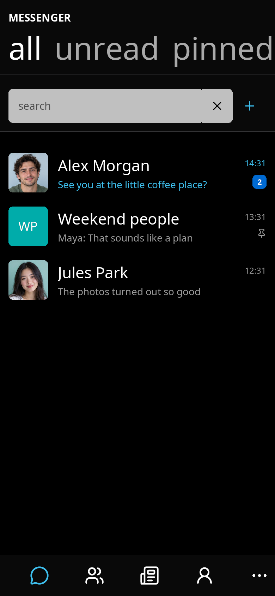
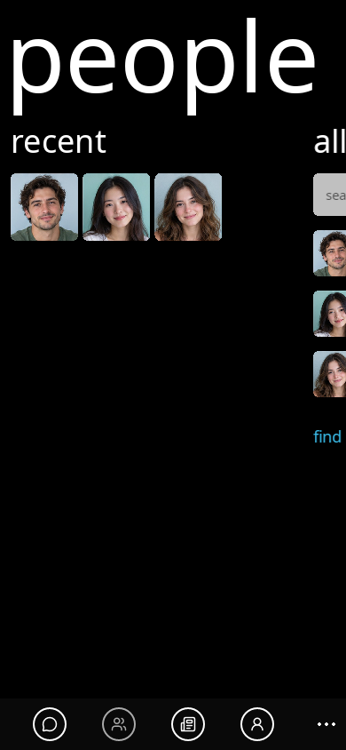
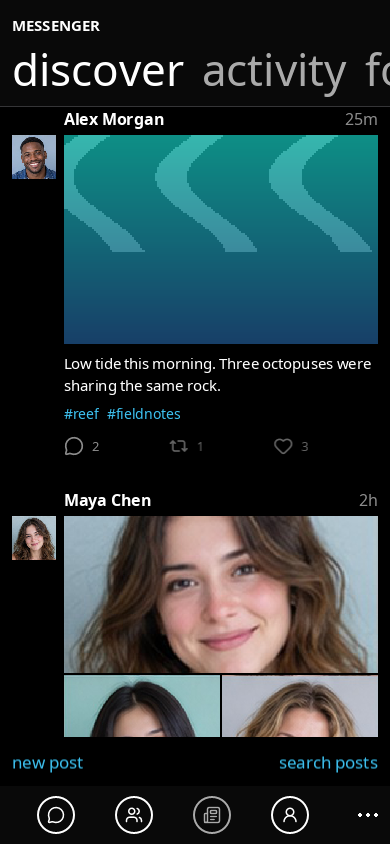
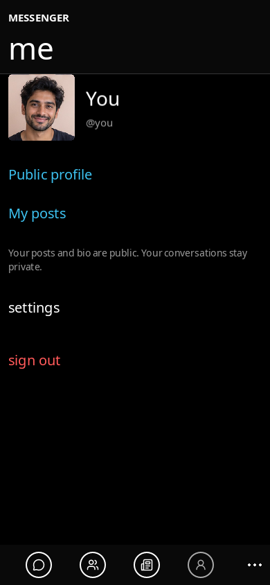
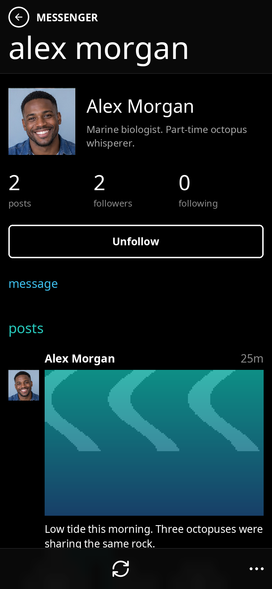
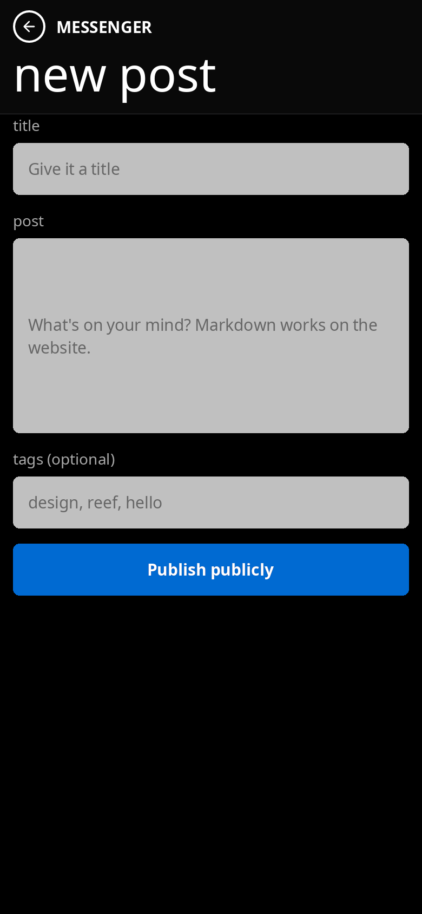
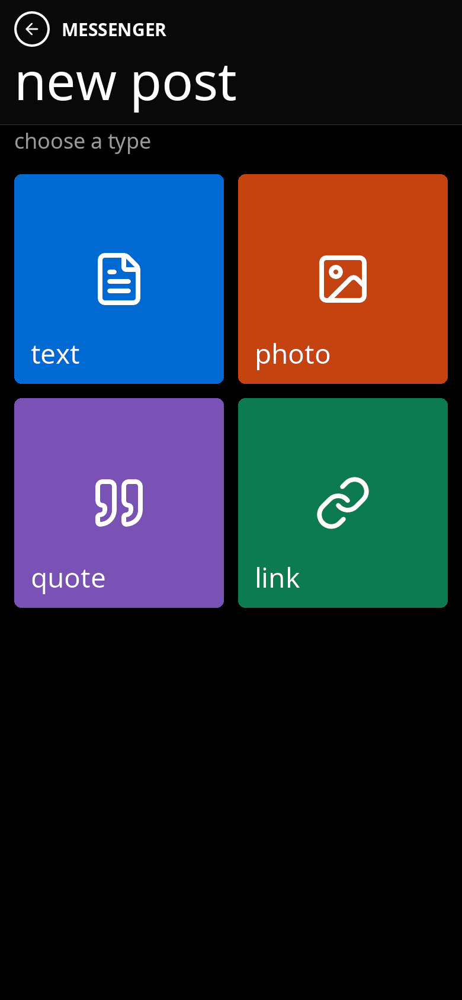
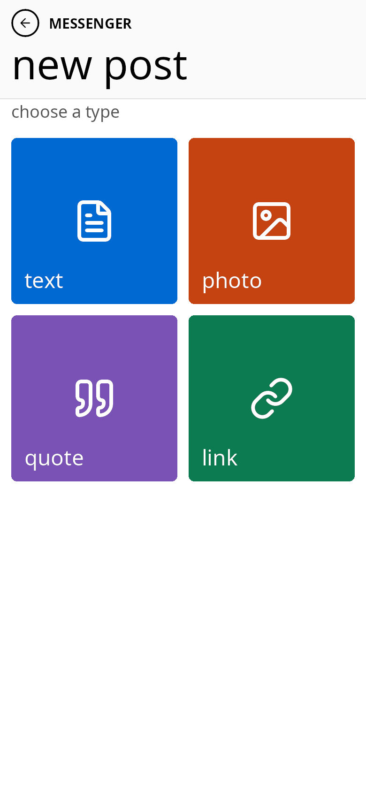

# Chat with public posts: native screenshots

Captured 8 November 2026 from the production Chat and Octopus XML/Lua views on
Linux/X11 with software OpenGL. The type-picker and composer PNGs are unretouched
**780 × 1688** native renders of the **390 × 844** logical layout at 2× density.
Earlier hub overview PNGs remain 390 × 844 at 1×. No screenshot is enlarged. The data comes from isolated offline mock clients and bundled fictional
portraits; no Appwrite request or live account is used. These are desktop native
captures, not iPhone simulator/device validation.

| Chats | People | Public posts |
| --- | --- | --- |
|  |  |  |

| Me | Person and public posts | Publish publicly |
| --- | --- | --- |
|  |  |  |

[Public posts in light mode](social-posts-light.png).

The public composer now has two pages: choose a type, then edit that type's
post. The colored square tiles and white icons/labels stay the same in both
themes. Back from the editor returns to the picker and preserves each draft.

| Choose a type | Compose the post | Type picker in light mode |
| --- | --- | --- |
|  |  |  |

## Reproduce

Build the native engine following [BUILD.md](../../../../docs/BUILD.md). From the
repository root, launch the isolated capture controller on an otherwise unused
390 × 844 display:

```sh
Xvfb :100 -screen 0 390x844x24 -nolisten tcp
```

In another terminal:

```sh
DISPLAY=:100 CHAT_BACKEND=mock CHAT_APPEARANCE=dark ORCA_CAPTURE_ROUTE=/posts \
  build/bin/orca -test=apps/chat/docs/screenshots/capture.lua
```

Wait for the feed and bundled images to finish loading, then capture that display
with ImageMagick in a third terminal:

```sh
DISPLAY=:100 import -window root /tmp/social-posts.png
```

Use `/`, `/contacts`, `/posts`, `/me`, `/posts/user`, `/posts/write` (type picker)
or `/posts/compose` (text editor) for
`ORCA_CAPTURE_ROUTE`. Use `CHAT_APPEARANCE=light` for the light capture. Close the
previous fixture before starting another; keep other tests on a different display.

The fixture signs into an isolated mock, opens the requested ordinary route,
selects Discover for feed captures and Alex Morgan for the public-person capture.
It bypasses page-transition animation and supplies explicit paint dimensions
because X11 exposure events can have no size payload. Layout, bindings, media,
styles, posts and actions remain the application's native implementations.

## Native 2× picker and composer captures

The original 1× screenshots look soft when enlarged. These three updated frames
render text and SVGs directly at twice the physical resolution. On X11, the
small fixture below simulates a 2× backing scale; it does not resize a PNG or
change application layout. It is a renderer validation fixture, not a device
claim or a production platform change.

```sh
cc -shared -fPIC apps/chat/docs/screenshots/density.c -o /tmp/orca-capture-density.so
Xvfb :101 -screen 0 780x1688x24 -nolisten tcp
```

In another terminal:

```sh
DISPLAY=:101 LD_PRELOAD=/tmp/orca-capture-density.so ORCA_CAPTURE_SCALE=2 \
  CHAT_BACKEND=mock CHAT_APPEARANCE=dark ORCA_CAPTURE_ROUTE=/posts/write \
  build/bin/orca -test=apps/chat/docs/screenshots/capture.lua
```

After the frame is painted, capture without resizing:

```sh
DISPLAY=:101 import -window root /tmp/social-post-types.png
```

Use `/posts/compose` for the editor and `CHAT_APPEARANCE=light` for the light
picker. The renderer regression checks curved fill/border pixels at 1×/2×;
`make test-vectorview-density` verifies actual SVG texture sizes at 1×/2×/3×.
The capture loop paints 20 warmup frames so startup bindings, SVG uploads and
the frosted header settle before the idle window is captured.
