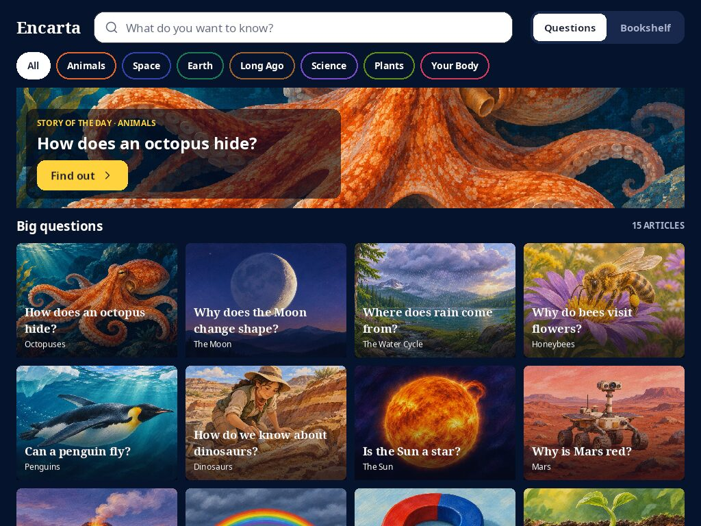
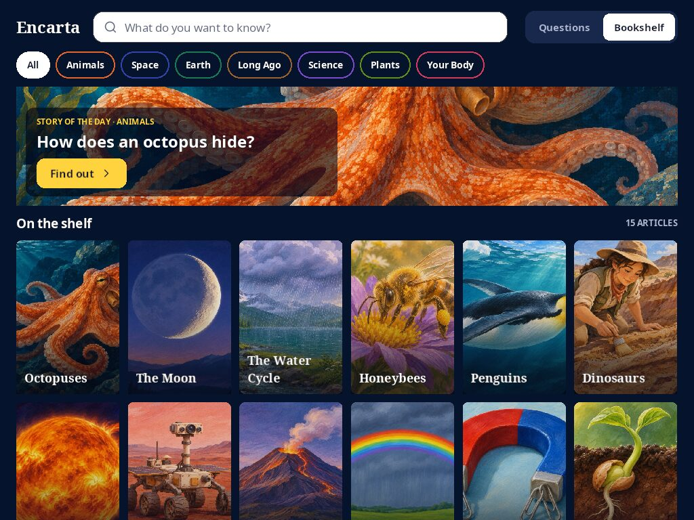
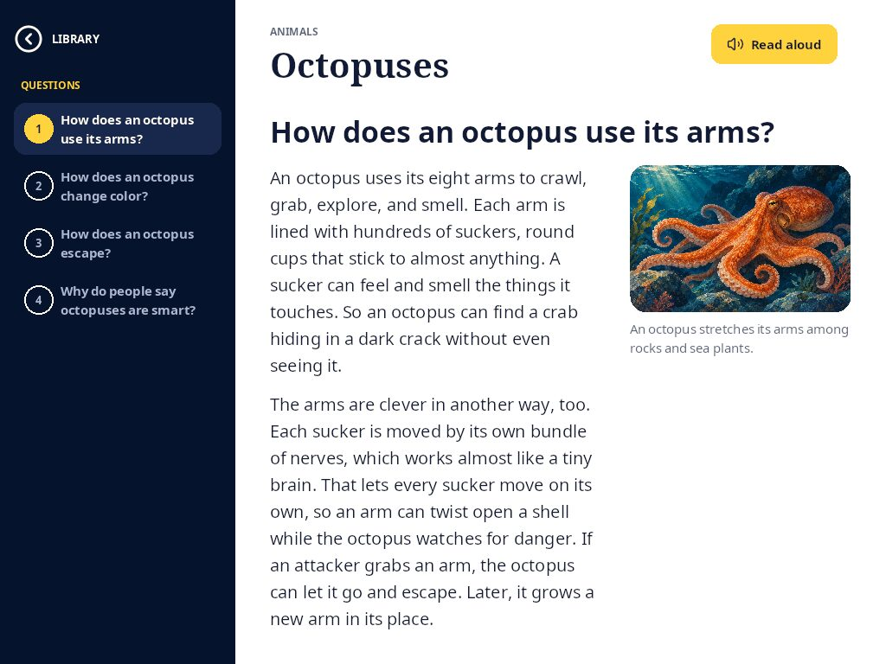
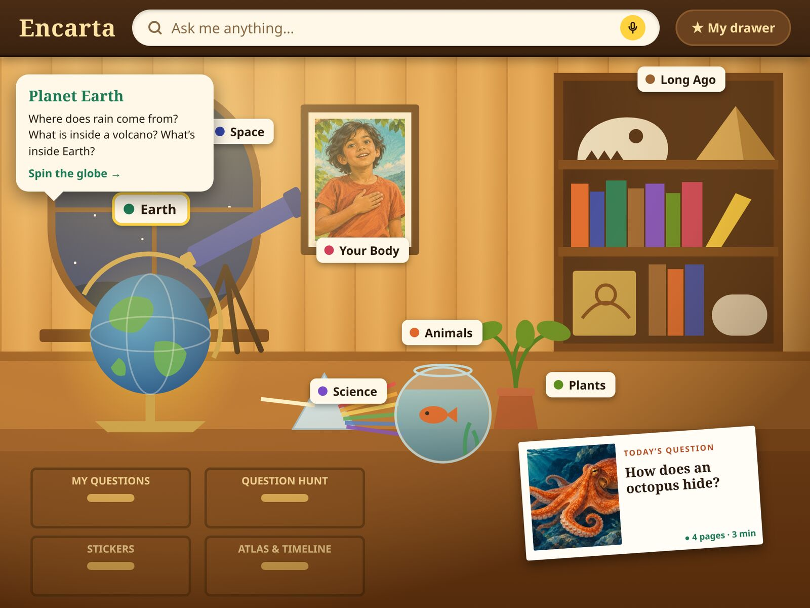
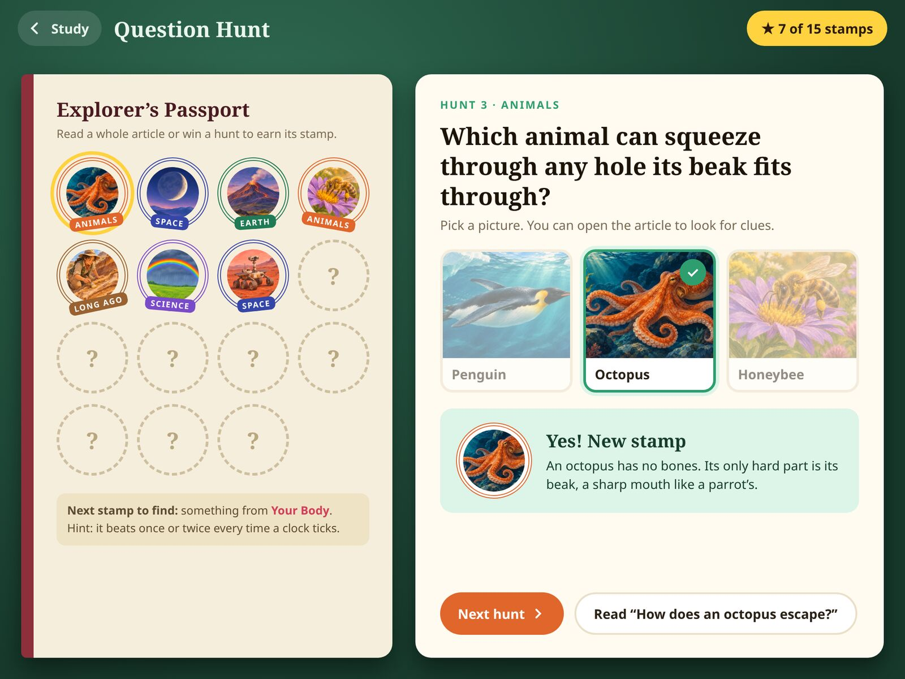

<!-- Saved copy of the design research page published at
     https://claude.ai/artifact/QToeuSHtU9xQpz7VDSWv3z (November 2026).
     The "where we are" screenshots show the app before the Study existed. -->

*Encarta · исследование дизайна*

# Кабинет исследователя

Как детские мультимедиа‑энциклопедии 90‑х и 2000‑х делали знание дружелюбным, где сейчас наш Encarta и три концепта следующего шага.

## Где мы сейчас

Снято с текущей ветки: собрал движок и запустил `apps/encarta` в окне 1024×768.

*Главная: «стена вопросов».*

*Режим «Книжная полка».*

*Статья: по вопросу на страницу.*

Что уже хорошо: голос статей в духе Was ist Was, единый стиль иллюстраций, чтение вслух с подсветкой слов, поиск и категории без сети. Слабое место в подаче. Главная выглядит как каталог стримингового сервиса: тёмный холодный фон, сетка, чипы. Это аккуратно, но безлико, и ребёнок здесь ничего не исследует. В статье картинка просто лежит рядом с текстом, а самые яркие места (удивительный факт, «попробуй сам») растворены в абзацах.

## Что делали тогда

Картинки с архивных сайтов из этой среды не открываются (сеть закрыта), поэтому разбор опирается на рецензии и описания того времени. Ссылки внизу страницы.

> **Про комнату с глобусом и ящиками.** Ближе всего подходит *The Ultimate Children’s Encyclopedia* (The Learning Company, конец 90‑х, по книгам Kingfisher). Главный экран там — комната мальчика Зака. Каждый предмет в ней открывает одну из 17 тем: животные, спорт, история и так далее. Зак сам ведёт по энциклопедии. В 1995 её анонсировали под названием *Zak’s Look‑it‑up!*. Желтоватое дерево, стол и глобус источники не подтверждают: там сказано только «комната Зака». Если это не она, следующие кандидаты — «Детская энциклопедия Кирилла и Мефодия» и *My First Encyclopedia*.

### Ultimate Children’s Encyclopedia

*The Learning Company · ~1998 · 7–12 лет*

Комната Зака: предметы и есть категории, Зак — гид. Внутри энциклопедия, словарь, тезаурус, атлас и хронология.

SuperKids: детям нравится (4/5), но искать конкретный ответ через комнату неудобно.

> Урок: комната для прогулки, а поиск всегда под рукой.

### Encarta Kids

*Microsoft · 2004–2009 · 7–12 лет*

Отдельная детская библиотека, больше 500 статей. Крупные иконки, яркие цвета, игры. На главной строка поиска и 10 крупных категорий.

> Урок: детский раздел — отдельное место со своим языком.

### DK Eyewitness Children’s Encyclopedia

*Dorling Kindersley · 1997 · 7–12 лет*

Объёмные сцены, где любой предмет ведёт к статье. Заметки‑стикеры на страницах, 40 видео, 90 анимаций, 2 часа звука. Рецензенты сравнивали главный экран с развивающей игрушкой Fisher‑Price.

> Урок: картинку можно исследовать, а не только смотреть.

### My First Encyclopedia

*Knowledge Adventure · 1994*

Большое дерево, по которому лазаешь, а на нём десять «комнат». Около 575 статей. Из комнаты выходишь обратно на дерево.

> Урок: одна понятная карта мира, к которой всегда возвращаешься.

### Random House Kid’s Encyclopedia

*Knowledge Adventure · ~1996*

Больше 170 «экскурсий» по темам, «Факт‑фабрика», аркада и кинотеатр.

> Урок: готовые маршруты и игры называют местами.

### Microsoft Explorapedia

*Microsoft · 1995*

По детской энциклопедии DK. Гид — лягушонок‑космонавт Тэд, инструмент «Эксплоратрон» для погружения в 4000 заметок, игра Wise Quackers.

> Урок: персонаж‑гид и игра поверх тех же статей.

### Encarta · Britannica · Compton’s

*взрослые CD‑энциклопедии · 1991–2009*

Индекс с поиском, статья со ссылками «см. также» и отдельная зона медиа. У Compton’s три окна: поиск, статья, медиа. Britannica хвалили за хронологии.

> Урок: связи между статьями и вторые оси — атлас и хронология.

### Детская энциклопедия Кирилла и Мефодия

*2003–2011*

Девять разделов, около 7300 статей, мультимедийные панорамы, интерактивная карта мира, 3D‑модели, детская справка.

> Урок: панорамы и карта как способ гулять по знаниям.

## Сравнение с нашим Encarta

| Приём тех лет | У нас | Что сделать |
| --- | --- | --- |
| Место вместо меню | нет: сетка и чипы | Главная как нарисованный кабинет: предметы открывают категории, поиск остаётся сверху. |
| Всегда видимый поиск | есть | Сохранить. Позже добавить голосовой вопрос для тех, кто ещё медленно печатает. |
| Картинку можно исследовать | нет | Номера на иллюстрации, по нажатию короткое пояснение. |
| Яркие вставки | в тексте | Карточки «Вот это да!» и «Попробуй сам» отдельными полями статьи. |
| «См. также» | нет | Одна‑две связанные статьи внизу страницы. |
| Игры по содержанию | нет | «Охота за вопросами» из готовых статей. |
| Личные следы | нет | Паспорт исследователя со штампами, «Мой ящик» для сохранённого. |
| Звук и голос | есть: чтение вслух | Озвучить остальные 12 статей. |
| Атлас и хронология | нет | Позже: «Давным‑давно» на ленте времени, «Земля» на глобусе. |
| Гид‑персонаж | нет | Под вопросом. Сам кабинет может быть «гидом», без маскота. |

## Три концепта

Макеты в размере iPad 1024×768, с нашими шрифтами Noto и настоящими иллюстрациями из `Images/`. Комната нарисована векторной заглушкой. В приложении её стоит заказать отдельной картиной в стиле `Artwork.md` и положить сверху прозрачные кнопки.

### Главная: кабинет исследователя

- Каждый предмет — категория: глобус «Земля», телескоп у окна «Космос», полка с черепом и пирамидой «Давным‑давно», призма «Наука», аквариум «Животные», росток «Растения», портрет «Твоё тело».
- Нажатие на предмет показывает облачко с вопросами раздела, а не уводит сразу в список.
- Ящики стола — личные и игровые места: мои вопросы, наклейки, охота за вопросами, атлас и хронология.
- «История дня» лежит на столе открыткой. Поиск с микрофоном сверху, на любом экране.
- Стена вопросов и полка остаются вторым видом. Ровно эту проблему рецензенты нашли у комнаты Зака.

### Статья: книжный разворот

- Левая страница для чтения, правая для разглядывания. Пустая колонка справа, как сейчас, исчезает.
- Номера на картинке открывают короткие подписи. Это приём DK, и его можно сделать данными: точка и текст.
- «Вот это да!» и «Попробуй сам» вынесены в карточки. Правила статей уже требуют их в тексте, остаётся дать им своё место.
- Вопросы — закладки сбоку книги вместо тёмной панели. Чтение вслух подсвечивает слово и затемняет прочитанное.

### Охота за вопросами и паспорт

- Вопросы собираются из готовых статей, одна правильная картинка из трёх. Отгадка ведёт в статью, как MindMaze в Encarta.
- Штамп дают за прочитанную статью или за отгадку. Пустые кружки подсказывают, что ещё можно найти.
- Без таймеров, очков и проигрыша: только находки.

## С чего начать

1. **Разворот статьи.** Самая дешёвая и заметная правка: новые необязательные поля `wow`, `try`, `hotspots`, `related` в `Articles.lua` и новая вёрстка `Section.xml`.
2. **Тёплая палитра.** Перевести тему с ночного синего на бумагу и дерево. Это затрагивает только `package.lua` и `app.css`.
3. **Кабинет на главной.** Нарисовать комнату, разметить предметы, оставить стену и полку вторым видом. Нужно проверить, держит ли UIKit абсолютно размещённые кнопки поверх картинки.
4. **Охота и паспорт.** Вопросы по статьям и локальное хранение прогресса.
5. **Потом:** ящики «Атлас» и «Хронология», озвучка остальных статей.

## Источники

- [SuperKids: Ultimate Children’s Encyclopedia](https://www.superkids.com/aweb/pages/reviews/encyclo2/uce/merge.shtml)
- [Neverdie Media: Ultimate Children’s Encyclopedia](https://www.neverdiemedia.com/products/ultimate-childrens-encyclopedia)
- [Ultimate Children’s Encyclopedia: история Zak’s Look‑it‑up!](https://encyclopediasdictionaries.blogspot.com/2011/08/ultimate-children-encyclopedia.html)
- [Microsoft: анонс Encarta Kids, 2004](https://news.microsoft.com/source/2004/07/07/microsoft-encarta-provides-fun-features-to-a-new-generation-of-students/)
- [Common Sense Media: Encarta Reference Library Premium 2005](https://www.commonsensemedia.org/game-reviews/encarta-reference-library-premium-2005)
- [SuperKids: Eyewitness Children’s Encyclopedia](https://www.superkids.com/aweb/pages/reviews/encyclo/3/witness/merge.shtml)
- [Eli’s Software Encyclopedia: Eyewitness Children’s Encyclopedia](https://elisoftware.org/wiki/Eyewitness_Children%27s_Encyclopedia_(PC,_CD-ROM)_DK_Multimedia_-_1997_USA,_Canada_Release)
- [RAWG: DK Eyewitness Children’s Encyclopedia](https://rawg.io/games/dk-eyewitness-childrens-encyclopedia)
- [TES: More than just a homework tool](https://www.tes.com/magazine/archive/more-just-homework-tool)
- [My First Encyclopedia: файл справки](https://discmaster.textfiles.com/file/15194/My%20First%20Encyclopedia%20&%20Spider-man%20Cartoon%20Maker.iso/tree.hlp/tree.pdf)
- [Lutris: My First Encyclopedia](https://lutris.net/games/my-first-encyclopedia/)
- [Kids Domain: Random House Kid’s Encyclopedia](https://discmaster.textfiles.com/file/19539/K_CD_8_98.iso/kdomain/wwwkid~1.com/review/kdr/random~1.htm)
- [Описание Microsoft Explorapedia: World of Nature](https://ubbthreads.com/store/item/Microsoft-Explorapedia-Children-s-Interactive-Encyclopedia-Nature-1995-PC-_185672430361.html)
- [Nextgov: CD Encyclopedias, 1998](https://nextgov.com/people/1998/08/cd-encyclopedias/256700)
- [Times Higher Education: Britannica CD](https://www.timeshighereducation.com/node/86633)
- [SuperKids: Compton’s Interactive Encyclopedia](https://www.superkids.com/aweb/pages/reviews/encyclo/3/compton/merge.shtml)
- [PC World: Детская энциклопедия Кирилла и Мефодия, 2003](https://www.osp.ru/pcworld/2003/02/165134)
- [Encyclopedia.ru: Детская энциклопедия Кирилла и Мефодия 2009](https://www.encyclopedia.ru/cat/soft/detail/41665/)
- [Microsoft: руководство по Encarta](https://download.microsoft.com/documents/uk/athome/SM_Learn_5MinEncarta_F.pdf)
