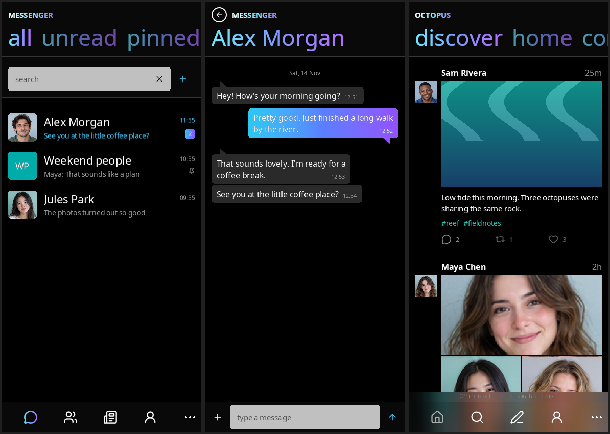
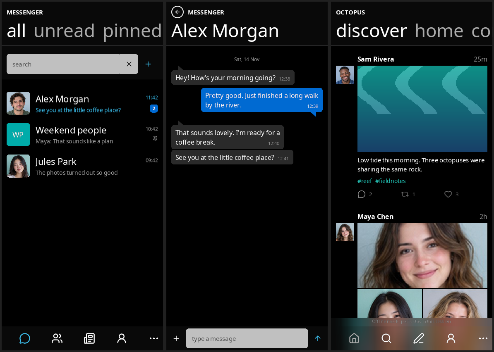
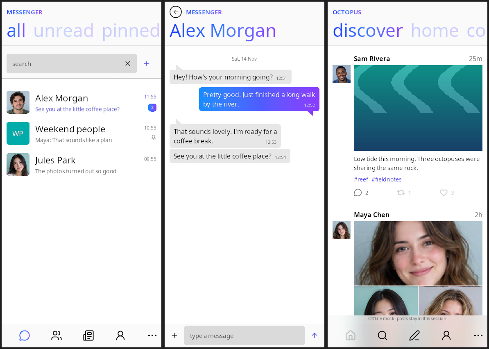
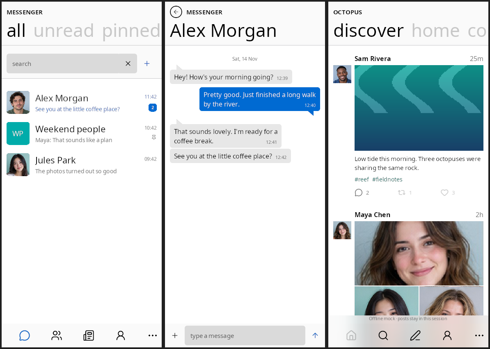

# Gradient look concept (Chat and Octopus)

Gradient display type and accents on the plain black or white canvas, after a
user-supplied promotional poster (white-to-cyan-to-violet type). The abstract
backdrop concepts were dropped (user decision, 14 November 2026): the canvas
stays black in dark appearance and white in light. This is still a **concept**
and is **not released**: the `looks.css` imports in
`apps/octopus/Styles/octopus.css` and `apps/chat/Styles/posts.css` are commented
out, so `ORCA_LOOK=neon` has no effect until they are restored. The default look
is unchanged and Chat's Windows Phone direction
([DESIGN.md](../../../apps/chat/DESIGN.md)) still applies.

Each strip shows the Chat inbox, a Chat conversation and the standalone Octopus
discover feed, rendered natively at 390 × 844 from offline mock data.

| | Neon | Current |
| --- | --- | --- |
| Dark |  |  |
| Light |  |  |

The gradient covers page titles, pivot headers, the selected app-bar icon,
unread badges, sent bubbles and primary buttons (which become pills). Light
uses a deeper blue-to-violet so type keeps its contrast on white, and tints
links and accent text to match.

## How it works

- `-orca-foreground-material` and `-orca-background-material` (CSS mappings to
  `Node2D.Foreground.Material` / `Background.Material`) attach a shader
  Material by path, as `background-image` attaches a texture.
- `Octopus/Shaders/Gradient` is one fragment-only shader: on text, a Pivot
  title/header or a `VectorView` it colours the glyph or SVG mask; as a
  background it fills the box. The engine's UI vertex stage keeps corner
  radii (see [UI Materials](../../renderer-internals.md#ui-materials)).
  `Octopus/Materials/Neon*` hold the colours as `Gradient.Color0` etc.: the shader
  declares its own uniforms; nothing is listed in `package.lua`. The shared visuals live in
  Octopus because Chat already builds on Octopus's views and stylesheet.
- `ORCA_LOOK=neon` adds `look-neon` and `look-neon-dark` or `look-neon-light`
  to the Screen beside the palette class (theme.lua);
  `apps/octopus/Styles/looks.css` holds the rules. Chat imports it after its own
  palette; Octopus loads it through `octopus.css`.

## Reproduce

Restore the two `looks.css` imports first.

```sh
DISPLAY=:100 CHAT_BACKEND=mock CHAT_APPEARANCE=dark ORCA_LOOK=neon \
  build/bin/orca -test=apps/chat/docs/screenshots/capture.lua
```

Use `CHAT_APPEARANCE=light` (or `OCTOPUS_APPEARANCE=light`) for the light strip.
